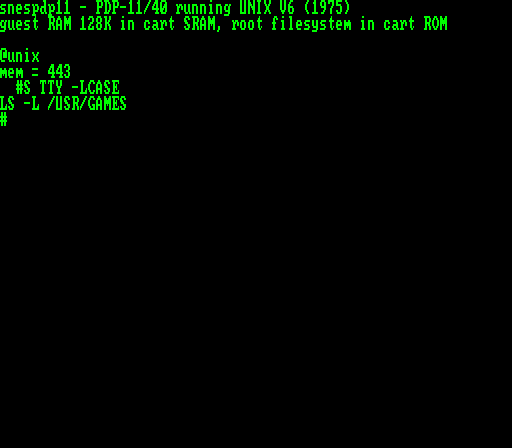

# snespdp11 — UNIX v6 on a Super Nintendo

Booting **real 1975 UNIX v6** on a stock SNES by emulating a **PDP-11/40** in
65816 code — root filesystem in cart ROM, guest core in cart SRAM. The hand-asm
PDP-11 core now boots v6 all the way to an interactive `#` shell on real SNES
hardware.



> ⚠️ **Disclaimer.** This is an experimental hobby project built largely with
> **AI assistance** (Claude Code). It is **provided AS IS, with no warranty of
> any kind**, and is **not thoroughly tested** — it may be incorrect or
> incomplete and may not work on your hardware or emulator. Use at your own risk.

**Project goal, status, and layout live in [`docs/PROJECT.md`](docs/PROJECT.md).**

## Quickstart (desktop core)

The portable C core boots v6 on any desktop — no SNES toolchain needed:

```sh
cd core-c && make && make test && cd ..          # build + run the CPU checks
gunzip -k roms/v6-golden.rom.gz
dd if=/dev/zero of=rk1.dsk bs=512 count=121       # swap "device" (APU RAM on SNES)
./core-c/pdp11 -r -o 64 roms/v6-golden.rom rk1.dsk
# at '@' type: unix ⏎  (CR matters) — login: root — ^] quits
# -r = read-only root + copy-on-write overlay (the cart-ROM rehearsal)
```

## Building the SNES ROM

The `snes/` build needs the [Calypsi](https://www.calypsi.cc/) 65816 toolchain
(proprietary, free for personal/hobby use) installed locally — see
`snes/Makefile`. Then, from `snes/`:

```sh
make asmboot                 # the asm core + v6 image -> build/asmboot.sfc
make test-asmcputest         # run the CPU-check suite on the SNES (Mesen)
```

## License

Project code: see the repository. UNIX v6 ships under the 2002 Caldera
"Ancient UNIX" license. The Calypsi toolchain is third-party and **not**
redistributed here.
